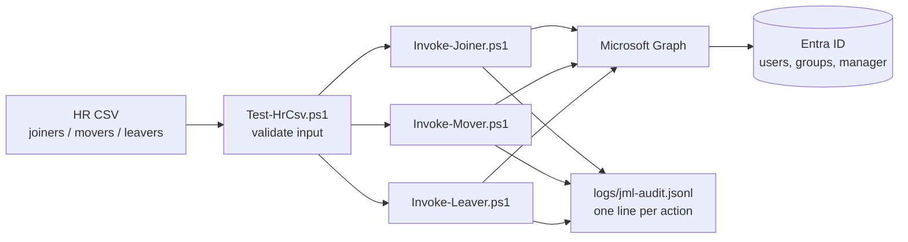

# Entra ID Joiner-Mover-Leaver Lab

A hands-on identity and access management (IAM) lab in Microsoft Entra ID (P2 trial), built in Oct–Nov 2026 as a second-year Management Information Systems student.

The goal was simple: run a fake company's identity lifecycle the way a real IT team should. That means new hires get the right access on day one, people who change teams lose their old access, and people who leave are cut off fast. Every step is logged and backed by a screenshot.

All users are fake. The tenant domain, tenant ID, object IDs and personal emails are redacted from every file and screenshot. In text files the domain is shown as `contoso.onmicrosoft.com`.

## What is in it



| Module | Topic | What I built |
| --- | --- | --- |
| M0 | Tenant setup | P2 trial, two break-glass Global Admin accounts (`bg-01`, `bg-02`), a separate least-privilege `lab-admin`, passkey policy, locked-down user settings |
| M1 | Users and groups | 12 users with HR attributes (department, employeeId, manager), dynamic department groups, group-based licensing, an administrative unit with a scoped role, B2B guest settings |
| M2 | PowerShell basics | `Test-HrCsv.ps1` validates HR input before anything touches the tenant; PSScriptAnalyzer clean |
| M3 | Microsoft Graph | Graph Explorer, a PATCH that returns 204 and shows up in the audit log, `Get-LabUserReport.ps1` read-only report |
| M4 | JML automation | Joiner, Mover and Leaver scripts with `-WhatIf`, idempotent re-runs (second run skips existing users) and a JSON audit log |
| M5 | Authentication | Passkeys, Temporary Access Pass, custom authentication strengths |
| M6 | Conditional Access | Baseline policies CA000–CA006 rolled out report-only first; break-glass excluded from every policy; What If tests; country block with named locations (left in report-only) |
| M7 | ID Protection | Sign-in risk and user risk policies (CA010, CA011); a real Tor sign-in raised risk detections |
| M8 | PIM | Eligible (not permanent) Helpdesk Administrator role with MFA, justification and approval on activation |
| M9 | Entitlement management | Finance catalog, access packages with manager approval and expiry, separation of duties: payment initiators cannot also request the approver package |
| M10 | Access reviews | Manager review of a budget-viewers group, with approve and deny decisions and reasons |

## Evidence

Screenshots live in [`docs/evidence/screenshots`](docs/evidence/screenshots). Redacted sample output is in [`docs/evidence/samples`](docs/evidence/samples).

| Control | Evidence | ISO/IEC 27001:2022 | NIS2 Art. 21(2) |
| --- | --- | --- | --- |
| Break-glass accounts, excluded from CA | `m0-breakglass-ga-assignments`, `m6-bg-acc-excluded-from-ca` | A.5.15, A.8.2 | (i) access control |
| Least-privilege admin | `m0-labadmin-roles`, `m1-au-finance-scoped-role` | A.8.2 | (i) |
| HR-driven joiner and mover | `m4v1-joiner-whatif`, `m4v1-joiner-run`, `m4v1-idempotent-skipped`, `m4v0-dyn-finance-after-joiner` | A.5.16, A.5.18 | (i) |
| Leaver: disable and revoke sessions | `samples/jml-audit.redacted.jsonl` | A.5.18 | (i) |
| Phishing-resistant MFA | `m0-passkey-policy`, `m5-auth-strengths`, `m5-tap-settings` | A.5.17, A.8.5 | (j) MFA |
| Conditional Access baseline | `m6-conditional-access-policies`, `m6-ca-policies-on-except-ca004`, `m6-fin-1-what-if`, `m6-fin-1-what-if-blocked-outside-country` | A.8.5 | (i), (j) |
| Risk-based access | `m7-ca010-ca011-risk-policies`, `m7-tor`, `m7-tor-risk-detections` | A.8.16 | (i) |
| Just-in-time admin (PIM) | `m8-eligible-assignment`, `m8-helpdesk-role-settings`, `m8-activation-pending` | A.8.2 | (i) |
| Access packages and SoD | `m9-ap-finance-reports-policy`, `m9-manager-approval`, `m9-sod-blocked` | A.5.15, A.5.18 | (i) |
| Access reviews | `m10-myaccess-manager-decisions`, `m10-myaccess-manager-decisions2` | A.5.18 | (i) |

## Mistakes I made and fixed

- **A policy blocked a user I didn't mean to block.** After turning the baseline on, `risk.test1` could not register MFA: error 53010 from CA005 (secure registration only from allowed locations) (`m6-registration-blocked-53010`). A new user needs a way to register before the registration policy bites, for example a Temporary Access Pass. Lesson: run What If for new users too, not only for existing ones.
- **Expected block, confirmed.** `fin.user1` got error 53003 from the country block, exactly as the What If test predicted (`m6-ca-fin-1-locked`).
- **Manager lookup failed for two joiners.** The audit log shows `SetManager: Failed` for E1001 and E1003 while user creation and group adds worked. The script logged the failure and kept going instead of stopping the whole run. Still open.
- **First leaver was manual.** Version 0 of the leaver was done by hand with no ticket number. That gap is why `Invoke-Leaver.ps1` writes an audit record for every action.

## Setup

Requirements: PowerShell 7.2+, `Microsoft.Graph.Authentication` module.

The JML scripts sign in as an app (workload identity) with a certificate. The IDs come from environment variables, never from the repo:

```powershell
$env:JML_TENANT_ID       = '<your tenant id>'
$env:JML_CLIENT_ID       = '<app registration client id>'
$env:JML_CERT_THUMBPRINT = '<certificate thumbprint in your user store>'

./scripts/Test-HrCsv.ps1    -CsvPath ./hr/joiners.sample.csv
./scripts/Invoke-Joiner.ps1 -CsvPath ./hr/joiners.sample.csv -UpnDomain contoso.onmicrosoft.com -WhatIf
```

Always run with `-WhatIf` first. Remove it only after the preview looks right.

## Repo layout

```
config/access-map.csv        department -> access group
hr/*.sample.csv              fake HR input
scripts/                     JML, reporting, CA and entitlement scripts
docs/evidence/screenshots/   redacted screenshots per module
docs/evidence/samples/       redacted audit log and user report
```

`.gitignore` keeps `logs/`, `out/`, `notes/`, certificates, `.env` files and real HR files out of git.
